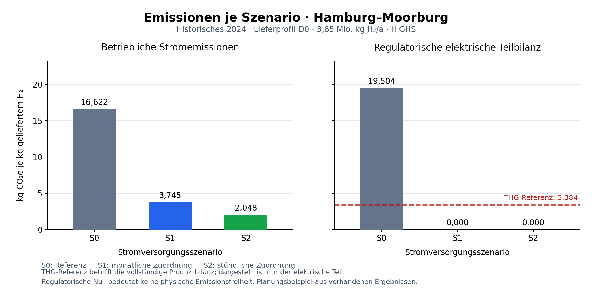

# Plan für den Neuaufbau der H₂-GUI und der Analysen

**Stand: 12. Oktober 2026 · U1 und sichtbare U2-Oberfläche umgesetzt; U3 und umfassende U4-Produktabnahme offen.**

Dieser Plan ist der Einstieg in den vollständig neu geordneten Analyseablauf. Der Nutzer hat als wichtigste Verbesserung gewählt: **„Das Analyseziel wählen und verständlich durch die Einstellungen geführt werden.“** Die Vorschläge unten konkretisieren dieses Ziel. Der erreichte U1-Teilstand ist in Abschnitt 16 und [GUI_U1_ABNAHME.md](GUI_U1_ABNAHME.md) dokumentiert; die aktuelle Bedienung steht in [GUI_BEDIENUNGSANLEITUNG.md](GUI_BEDIENUNGSANLEITUNG.md). Die aktive U2-Oberfläche und ihre Grenzen sind in Abschnitt 17 dokumentiert.

Projektordner: `C:\Forschungsarbeit\Opt_H2_Meric-h2`. Planung, Umsetzung und spätere Anleitung gehören in diesen Modellordner. Der OneDrive-Chatordner dient lediglich zur Arbeitsvorbereitung.

## 1. Auftrag und verbindliche Grenzen

Wir wollen die GUI und die fachliche Ordnung der Analysen neu aufbauen. Der Einstieg erfolgt über eine verständliche Forschungsfrage. Anschließend führt die Oberfläche durch die dafür nötigen Einstellungen, zeigt den Umfang der Untersuchung und stellt die passenden Ergebnisse dar.

Festgelegt ist:

- Im ursprünglichen Planungsschritt wurde zunächst diese Markdown-Datei erstellt; GUI-Funktionen und Modellfälle blieben damals unverändert. Der anschließend autorisierte U1-Schritt ist in der lokalen U1-Revision umgesetzt (Abschnitt 16).
- Der bestehende wissenschaftliche Funktionsumfang bleibt vollständig erhalten. Modellparameter, Sensitivitäten, Fallstudien, Standorte, Szenarien, Solver, Ergebnisgrößen, Quellen und Validierung dürfen beim Umbau nicht verloren gehen.
- H₂-Jahresnachfrage und H₂-Lieferprofil bleiben normale Sensitivitätsparameter. Eine gezielte Führung zur Nachfrageanalyse verwendet denselben Parametereditor, keinen zweiten Sonderweg.
- Die bisher verlangten fünf Hauptbereiche bleiben im vorgeschlagenen Entwurf erhalten: **Analyse, Sensitivitätsanalyse, Vergleich, Quellen, Export**. Die Führung erfolgt innerhalb dieser Bereiche; zusätzliche Planungs-, Start- oder Ergebnis-Seiten sind nicht vorgesehen.
- Streamlit und die vorhandenen nativen Runner bilden zunächst weiter die technische Grundlage. Die Neuordnung der Oberfläche erhält keine eigene Kopie der Modellgleichungen.
- **Konkretisierung vom 10.10.2026:** Die GUI bietet wenige fachlich festgelegte Diagramme passend zum Analyseziel. Eine regulatorische THG-Grenze wird als gestrichelte Referenz in der passenden Emissionsanalyse gezeigt, niemals als eigenständige Ergebnis- oder Sensitivitätskurve. Der Nutzer soll weder eine lange Liste technischer Kennzahlen durchgehen noch sinnlose Kombinationen von Größe und Diagrammtyp zusammenstellen müssen.
- Bestehende Inputs, Ergebnisdateien und Prüfberichte bleiben erhalten. Neue Ausführungen bekommen eigene Ablagen.
- Das Manuskript bleibt zurückgestellt. Eine neue PDF ist für diesen Planungsschritt nicht vorgesehen.

Der Umbau betrifft zunächst die Auswahl, Zusammenstellung, Darstellung und Interpretation vorhandener Analysen. Neue wissenschaftliche Methoden oder Modellgleichungen werden als separate Erweiterungen geplant und nicht stillschweigend mit einer GUI-Änderung eingeführt.

## 2. Geprüfter Ausgangspunkt

Die Bestandsaufnahme beruht auf dem tatsächlichen Stand von `gui/app.py`, `gui/analysis_intent.py`, `gui/sensitivity_design.py`, `gui/model_adapter.py`, `gui/case_studies.json`, den nativen Sensitivitätsparametern und der Projektdokumentation.

| Heute vorhanden | Konsequenz für den Neuaufbau |
|---|---|
| Fünf Hauptbereiche; Berechnungen und Ergebnisse auf derselben Seite | Diese direkte Bedienung erhalten; den Einstieg fachlich führen. |
| Neue Analyse beginnt sichtbar mit Profil-, Szenario- und Solverauswahl | Zuerst die Forschungsfrage zeigen; danach die dazu passenden Auswahlfelder. |
| Analyseziele sind in `analysis_intent.py` bereits beschrieben; die zugehörigen Auswahl-/Vorschaufunktionen werden im aktuellen Hauptablauf nicht verwendet | Vorhandene Definitionen prüfen und zusammenführen; keine zweite, widersprüchliche Zielauswahl bauen. |
| Gespeicherte Basis- und Sensitivitätsreihen sind auswählbar | Ergebnisherkunft sichtbar halten, ohne dem Nutzer technische Pfade als Hauptauswahl aufzubürden. |
| Tagesbetrieb eines Sensitivitätsfalls lässt sich bereits in Analyse öffnen | Diesen Zusammenhang verständlicher machen und die genaue Fallbindung erhalten. |
| Identische Ausführungen werden vorsichtig zusammengefasst | Eine wissenschaftliche Fallansicht mit zugänglicher Ausführungshistorie erhalten. |
| Quellen, Jahresrollen, native Parameter und unabhängige Prüfungen sind vorhanden | Kurze fachliche Zusammenfassung und vollständige Details anbieten. |
| Die GUI startet derzeit einen Standortauftrag; Hamburg und Huelva werden getrennt gestartet | Ein gemeinsamer Auftrag für beide Standorte wäre zusätzliche GUI-Orchestrierung und muss gesondert geprüft werden. |

Der bisherige Bestandsabgleich vom 6. Oktober dokumentiert **46/46 bestandene Prüfungen**. Er ist eine Referenz für den vorhandenen Funktionsumfang, keine Abnahme dieses noch geplanten Umbaus.

## 3. Empfohlenes Zielbild: Forschungsfrage → Einstellungen → Ergebnis

Die sichtbare erste Frage lautet: **„Was möchten Sie untersuchen?“**

Eine Auswahl mit kurzen Erläuterungen führt zum passenden Formular. Die Oberfläche zeigt anschließend jederzeit:

1. **Analyseziel:** Welche Frage beantwortet die Untersuchung?
2. **Bezugsfall:** Welche Fallstudie, welcher Standort und welche Jahres-/Datenbasis gelten?
3. **Variation:** Was verändert sich, und welche Größen bleiben für den Vergleich konstant?
4. **Umfang:** Welche konkreten Fälle sind ausgewählt, und wie viele Optimierungen entstehen?
5. **Ergebnis:** Welche Kennzahlen und Diagramme beantworten die gewählte Frage?

Diese Schritte sind Abschnitte einer Arbeitsseite. Bereits eingegebene Werte bleiben sichtbar und änderbar; eine Folge zahlreicher separater Weiter-Seiten ist nicht vorgesehen. Fachlich nötige Einstellungen werden unmittelbar angezeigt. Zusätzliche technische Optionen bleiben über eindeutig benannte Detailabschnitte erreichbar.

**Vorgeschlagenes Seitenlayout:**

```text
Was möchten Sie untersuchen?  [Analyseziel mit kurzer Erklärung]

Fallstudie / Standort(e) / Datenbasis
Passende Einstellungen für dieses Analyseziel
Weitere Optionen: Solver, vollständige Parameter und Quellen

Ihre Untersuchung: Bezugsfall · Variation · Fallanzahl
[Gespeicherte passende Ergebnisse öffnen]  oder  [Berechnen]

Fortschritt und Ergebnisstatus
Kernergebnisse · Vergleich · Betrieb eines einzelnen Falls
Quellen und Prüfnachweis des ausgewählten Falls
Export der angezeigten Auswahl
```

„Gespeicherte Ergebnisse öffnen“ liest vorhandene Resultate. Ein Modelllauf beginnt ausschließlich über den sichtbaren Berechnungsbutton. Ein Wechsel von Ziel, Datum, Diagramm, Filter oder Ergebnisfall darf keine Optimierung auslösen.

## 4. Fachlicher Katalog der Analyseziele

Die folgenden acht Einstiege sind ein Vorschlag. Sie ordnen vorhandene Funktionen nach der Frage des Nutzers; sie bedeuten nicht acht neue Modellmethoden.

| Analyseziel in verständlicher Sprache | Fachliche Frage und Variation | Führung und erste Ergebnisdarstellung |
|---|---|---|
| **Eine Anlage optimal auslegen** | Welche kostenoptimale Anlage erfüllt die Nachfrage am gewählten Standort? Keine Parametervariation. | Einen Standort, ein Profil und ein Szenario wählen; LCOH, Jahreskosten, Kapazitäten und Betrieb zeigen. |
| **Stromversorgungsregeln vergleichen** | Wie ändern S0/S1/S2 bzw. das native S3 die Kosten und Auslegung? Nur das Szenario verändert sich innerhalb eines Vergleichs. | Mindestens zwei Szenarien; Standort, Menge und Profil konstant halten. LCOH und Kapazitäten nebeneinander. |
| **Kleinere oder größere H₂-Nachfrage untersuchen** | Wie verändert die Jahresmenge die optimale Auslegung bei gleichem Lieferprofil? | Nachfrageparameter vorwählen; Mengen als Prozent der Basis und kg/a zeigen. Kosten, Kapazitäten, LCOH und Netzbezug über der Nachfrage. |
| **H₂-Lieferzeiten vergleichen** | Wie wirken D0/D1/D2 bei gleicher Jahresmenge auf Kosten, Speicher und Betrieb? | Lieferprofilparameter vorwählen; tatsächliche Lieferfenster erklären. LCOH, Speicher und Produktion/Lieferung vergleichen. |
| **Kosten, Finanzierung oder Technik variieren** | Wie empfindlich reagieren die Ergebnisse auf jeweils einen veränderten Einfluss? | Normalen vollständigen OAT-Parametereditor öffnen. Sensitivitätskurven mit eigener passender Basis anzeigen. |
| **Standorte oder vorhandene Fälle vergleichen** | Welche Unterschiede zeigen gezielt ausgewählte Fälle, und wie vergleichbar sind ihre Grundlagen? | Standort-/Fallauswahl und Bezugsgrundlagen zeigen; zunächst vorhandene Fälle vergleichen. Gemeinsam neu berechnete Standortaufträge sind eine geplante Erweiterung. |
| **Den Betrieb einer Anlage ansehen** | Wie arbeiten Erzeugung, Netzbezug, Elektrolyse und Speicher in einem bereits berechneten Fall? | Exakten Ergebnisfall und Zeitraum wählen. Tages-, kumulative Tages- und Stundenansichten in Analyse öffnen. |
| **Solver vergleichen** | Wie unterscheiden sich HiGHS und Gurobi bei identischen Modelleingaben? | Dieselben Fälle explizit mit beiden Solvern; Kosten, Status, Laufzeit und mögliche alternative Optima vergleichen. |

### Zuordnung zu den fünf Hauptbereichen

- **Analyse:** optimale Auslegung, Szenarienvergleich, Solververgleich und Betrieb einzelner Fälle. Zusätzlich gespeicherte Fälle sämtlicher Reihen öffnen.
- **Sensitivitätsanalyse:** Nachfragemenge, Lieferprofil und alle wirtschaftlichen/technischen OAT-Parameter. Die drei zielgerichteten Einstiege verwenden dieselbe Variationslogik.
- **Vergleich:** bereits berechnete Fälle gezielt gegenüberstellen, einschließlich Standorten, Szenarien, Profilen und ausgewählten Sensitivitätsfällen.
- **Quellen:** gemeinsame verständliche Herkunftsübersicht plus vollständige native Annahmen und Nachweise.
- **Export:** genaue sichtbare Auswahl mit Fallbezug herunterladen; derselbe Export darf auch direkt beim Ergebnis erreichbar sein.

Eine Weiterleitung übernimmt den ausgewählten Fall bzw. die Einstellungen. Ein Nutzer soll Datum und Fall nicht erneut zusammensuchen müssen, wenn er aus einer Sensitivitätskurve den Betrieb einer Variante öffnet.

Die geführten Standardfälle begrenzen den Funktionsumfang nicht: Die bisherige ausdrücklich gewählte Mehrfachauswahl von Profilen und Szenarien bleibt über eine verständliche erweiterte Fallauswahl erreichbar. Die älteren engeren Auswahlregeln in `analysis_intent.request_scope` dürfen nicht unverändert zum alleinigen neuen Planer werden; sie decken den aktuellen Gruppen- und kategorischen OAT-Umfang nicht vollständig ab.

## 5. Wissenschaftliche Regeln der Analyseführung

### 5.1 Bezugsfall und veränderte Größe

Jede Sensitivitätsgrafik bezeichnet ihre Referenz ausdrücklich. Standort, Profil, Szenario, Solver, Inputvertrag und Basisparameter gehören zur Vergleichsidentität. Eine numerische Variante wird mit ihrem eigenen passenden Basisfall verglichen.

Mehrere ausgewählte Parameter ergeben **Einzelfaktoranalysen (OAT)**: pro Variante wird eine Parameterfamilie geändert. Mehrere Basisprofile erhalten getrennte OAT-Reihen. Zusätzliche kategorische Profilstufen bekommen wie bisher unveränderte Basisfälle; sie erzeugen keinen versteckten Kreuzversuch mit allen numerischen Varianten.

Eine ausdrücklich gewählte Untersuchung über Standorte × Basisprofile × Szenarien ist als Gruppenstruktur sichtbar. Das ist von der gleichzeitigen Variation mehrerer numerischer Einflussfaktoren zu unterscheiden.

### 5.2 Nachfragemenge

Die bereits vereinbarten Stufen **50, 75, 100, 125 und 150 %** bleiben die vorgeschlagene Standardbelegung. Die EU-Basis beträgt **3.650.000 kg/a**. Damit entsprechen die Stufen 1.825.000, 2.737.500, 3.650.000, 4.562.500 und 5.475.000 kg/a.

Der Nachfragefaktor skaliert jede Stunde des gewählten Profils proportional. Lieferfenster und Form des Profils bleiben erhalten. **100 % erscheint einmal als Basis**, nicht zusätzlich als vermeintlich neue Sensitivitätsvariante.

Beispiel: Hamburg und Huelva × D0/D1/D2 × S0/S1/S2 × fünf Nachfragemengen = **90 Jahresfälle**, bei einem Solver und ohne zusätzliche numerische Variationen. Diese Untersuchung ist bereits gerechnet und validiert; die GUI soll sie verständlich zugänglich machen. Ein neuer gemeinsamer Standortauftrag ist im aktuellen GUI-Ablauf noch nicht implementiert.

Für jede Nachfragemenge werden Kapazitäten und Betrieb neu optimiert. Das vorhandene lineare Modell enthält keine Größendegression der Investitionskosten. Proportionale Jahreskosten und nahezu konstante LCOH können daher eine Folge des Modellaufbaus sein. Andere Kapazitäts-/Betriebsaufteilungen können bei alternativen Optima auftreten. Eine Auswertung darf daraus weder allgemeine industrielle Skaleneffekte noch die Belastbarkeit einer feststehenden Bestandsanlage ableiten.

### 5.3 Lieferprofil

- **D0:** Lieferung rund um die Uhr.
- **D1:** Lieferung täglich 08–20 Uhr Ortszeit.
- **D2:** Lieferung Montag–Freitag 08–20 Uhr Ortszeit; keine zusätzliche Feiertagskorrektur.

Die Jahresmenge bleibt bei einem reinen Profilvergleich konstant. Diese Fenster betreffen die Pflichtlieferung, nicht die zulässigen Produktionsstunden. Die Profile sind synthetische Annahmen, keine gemessenen Kundennachfragen. Namibia besitzt im registrierten Bestand ausschließlich D0.

### 5.4 Jahresrollen und Emissionen

Für die aktuelle EU-Studie gelten historischer Wetter-/Marktkalender **2024 mit 8.784 Stunden**, betriebliche statische Emissionsreferenz **2024**, reale Geldbasis **EUR 2023** und dokumentierter **WACC-Proxy aus 2021**. Der regulatorische Faktor besitzt eine eigene normative Referenz. Diese Rollen werden kompakt angezeigt und in Quellen vollständig erklärt; sie werden durch den GUI-Umbau nicht geändert.

Namibia bleibt eine historische Vergleichsstudie mit TMY-Wetter und abweichenden dokumentierten Grundlagen. Ein Vergleich mit EU 2024 zeigt diese Einschränkungen vor der Interpretation.

Betriebliche Emissionen und regulatorische elektrische Teilbewertung werden getrennt dargestellt. Die aktiven EU-Fälle besitzen statische Länderreferenzen; ein wechselnder Netzbezug ergibt noch keine dynamischen Netzemissionsfaktoren. Die vorhandenen RED-Teilprüfungen werden nicht als vollständiger Zertifizierungsnachweis bezeichnet.

### 5.5 Gemeinsame Namibia-/EU-Sensitivitätsdefinition

Die bestehende gemeinsame Belegung bleibt erreichbar: Verschiebung der Preisreihe um **±50 % ihres jeweiligen Jahresmittels**, WACC-Multiplikation jeder Komponente mit **7/11 bzw. 15/11** sowie die dokumentierten technischen Stufen. Preisverlauf und standortspezifische Finanzierung bleiben dadurch in ihren jeweiligen Bezugsfällen erhalten.

Der Editor unterscheidet direkte Werte, relative Prozentänderungen, Faktoren und Prozentpunkte. Beispielsweise wird eine WACC-Verschiebung um einen Prozentpunkt nicht als relative Änderung um ein Prozent interpretiert. Vor dem Rechnen zeigt eine Vorschau den tatsächlich an den Runner übergebenen Wert mit Einheit.

## 6. Bestandsliste der Parameter: vor dem neuen Umbau

Diese Tabelle hält den aktuellen Freigabestand fest. **13 numerische Parameter sind nativ inventarisiert; die aktuelle GUI bietet elf je Fallstudie an.** Zusätzlich ist das Lieferprofil bei den EU-Fällen kategorisch auswählbar. Eine vorhandene native Fähigkeit, die bisher nicht für die GUI freigegeben ist, wird durch die Planung nicht automatisch aktiviert.

| Nativer Parameter | Verständliche Bezeichnung / Einheit | EU-GUI | Namibia-GUI |
|---|---|---|---|
| `electricity_price_eur_per_mwh` | Konstanter Strompreis [EUR/MWh, Geldbasis fallbezogen] | – | ja |
| `electricity_price_offset_eur_per_mwh` | Verschiebung der Preisreihe [EUR/MWh, Geldbasis fallbezogen] | ja | ja |
| `real_wacc_shift_fraction` | Änderung aller Komponenten-WACC [Prozentpunkte in GUI] | ja | ja |
| `real_wacc_multiplier` | Faktor für alle Komponenten-WACC [–] | ja | ja |
| `uniform_real_wacc_fraction` | Einheitlicher realer WACC [% in einer GUI-Eingabe] | nativ, derzeit nicht angeboten | nativ, derzeit nicht angeboten |
| `pv_capex_eur_per_kw` | PV-CAPEX [EUR 2023/kW] | ja | ja |
| `wind_capex_eur_per_kw` | Wind-CAPEX [EUR 2023/kW] | ja | ja |
| `h2_storage_capex_eur_per_kg_h2` | Speicher-CAPEX [EUR 2023/kg H₂] | ja | ja |
| `electrolyzer_capex_eur_per_kw` | PEM-CAPEX [EUR 2023/kW] | ja | ja |
| `electrolyzer_specific_electricity_kwh_per_kg_h2` | PEM-Strombedarf [kWh/kg H₂] | ja | ja |
| `electrolyzer_capex_factor` | Faktor für PEM-CAPEX [–] | ja | ja |
| `electrolyzer_specific_electricity_factor` | Faktor für PEM-Strombedarf [–] | ja | ja |
| `h2_demand_multiplier` | H₂-Jahresnachfrage [% der Basis bzw. Faktor] | ja | – |
| `h2_delivery_profile` | Lieferprofil D0/D1/D2 [kategorisch] | ja | nur D0 im Bestand; keine Profilvariation |

Direkte und relative Eingaben für die technischen Parameter sowie explizite Werte und Wertebereiche bleiben erhalten. Das einheitliche WACC-Verfahren bleibt als native Fähigkeit dokumentiert; seine bisher fehlende allgemeine GUI-Freigabe darf nicht mit einer Entfernung verwechselt werden. Die volle native Basiskonfiguration bleibt lesbar, auch wenn nicht jede Basisgröße ein freigegebener Sensitivitätsregler ist.

Weitere zu erhaltende Bestandsgruppen:

| Gruppe | Vollständig zu erhalten |
|---|---|
| Fallstudien / Standorte | EU 2024 mit Hamburg und Huelva; historische Namibia-Referenz einschließlich Kompatibilitätsprüfung; Registry-Erweiterbarkeit |
| Szenarien | S0 Referenz, S1 monatliche Zuordnung, S2 stündliche Zuordnung und das vorhandene native S3 ohne Netzbezug |
| Solver | SciPy/HiGHS, Gurobi, expliziter Auto-Pfad, Vergleich beider Solver, Verfügbarkeits-/Lizenzprobe |
| Kennzahlen | LCOH, Jahreskosten, produzierte und gelieferte Jahresmenge, PV/Wind/PEM/Kompressor/Speicher, Netzbezug, absolute und spezifische betriebliche/regulatorische Emissionen, vollständige native Tabellen und der vollständige bisherige Diagramm-Kennzahlkatalog |
| Kosten und Betrieb | Native Kostenbestandteile, Stundenproduktion/-lieferung, Speicher, Erzeugung, Eigenversorgung, Abregelung und Netzbezug, soweit im jeweiligen Ergebnis belegt |
| Quellen / Prüfung | Quellenlinks, Werte, Einheiten, Jahresrollen, Annahmen, Input-/Parameter-Hashes, ergebnisgebundene unabhängige Prüfung und RED-Teilprüfungen |
| Weitere Kennzahlen / Diagnostik | THG-Einsparung und -Grenzen, regulatorisch nicht erneuerbare Strommenge, g CO₂e/MJ, physischer EE-Anteil und Abregelung, Solverlaufzeit/-Lücke sowie Strom-/H₂-/Kostenbilanzresiduen und zeitliche Deckungsdefizite, soweit der konkrete native Fall sie enthält |
| Ausführungen | Fortschritt, Logs, Fehler, frühere Aufträge, Originalpfade und getrennte Herkunft identischer Ausführungen |
| Exporte | Ergebnistabellen, Sensitivitäts-/Vergleichstabellen, Tagesdaten, PNG/SVG mit Grafikdaten, native ZIP-Dateien, Metadaten und Validierungs-JSON; vorhandene Anleitung und historische PDF |

Vor einer Implementierung wird diese Liste maschinenlesbar gegen Adapter und Registry bestätigt. Nach der Implementierung wird sie erneut abgeglichen. Der Umbau darf keine Position mit dem pauschalen Hinweis „vereinfacht“ auslassen.

Die bestehende Bestandsliste enthält auch historische Zwischenstände. Ihre ältere Erwähnung einer Tagesdarstellung in zwei Bereichen ist durch die spätere Zuordnung und den aktuellen Code überholt: Tagesbetrieb liegt in Analyse, mit direkter Weiterleitung aus der Sensitivitätsansicht.

## 7. Neuordnung der Ergebnisansicht und Diagramme

### 7.1 Gleiche Grundstruktur für alle Ziele

Oben steht eine kurze Antwort anhand der zum Analyseziel passenden Kennzahlen. Darunter folgt **eine fachlich festgelegte Hauptgrafik**, anschließend die vollständige Tabelle und die Details eines konkreten Falls. Weitere Ansichten werden über wenige verständliche Begriffe wie **Kosten, Auslegung, Betrieb und Emissionen** geöffnet, nicht als lange automatische Diagrammfolge ausgegeben.

Der Standardablauf bietet keine beliebige Kombination aus einer langen Kennzahlliste, Diagrammtyp, Gruppierung und Achseneinstellungen. Diagrammtyp, Achsen, Einheiten, Referenzlinien und Legenden folgen aus der fachlichen Frage. Sichtbar bleiben nur die dafür nötigen Angaben, beispielsweise Profil, Szenarioauswahl, Parameterstufen oder Tag. Der vollständige Kennzahlbestand bleibt in der Ergebnistabelle, im Export und für Prüfgrößen unter **Modellprüfung** erhalten.

Die zusammenfassende Ansicht empfiehlt passende Größen, entfernt aber keine Ergebniskennzahl. Vollständige Werte und native Dateien bleiben erreichbar. Fehlende Größen werden als nicht verfügbar ausgewiesen; sie werden nicht durch angenommene Werte oder Null ersetzt.

### 7.2 Diagrammkatalog

| Frage / Ansicht | Empfohlene Hauptgrafik | Weitere gezielt erreichbare Ansichten |
|---|---|---|
| Szenarien- oder Standortvergleich | LCOH als gruppierte Balken | Kapazitäten, Kostenbestandteile, Netzbezug, Betrieb, getrennte Emissionen |
| Nachfragemenge | Absolute Jahreskosten oder Kapazitäten über der Jahresnachfrage | LCOH, Netzbezug, normierte Änderung zur eigenen Basis; getrennte Kurven je Profil/Szenario |
| Lieferprofil | Speicherbedarf und LCOH je D0/D1/D2 | Kapazitäten, gewählter vergleichbarer Betriebszeitraum, Produktion gegenüber Lieferung |
| Numerische Sensitivität | Gewählte Kennzahl über dem tatsächlichen Parameterwert | Relative Ergebnisänderung zur passenden Basis, gruppierte Balken; Parametereinheit und Basiswert sichtbar |
| Einzelner Tag: Stromversorgung | Stündlicher Verlauf der Direktversorgung und des Strombedarfs | Kumulative Tagesenergie; alternativ Erzeugung und Netzbezug |
| Mehrere Stunden: H₂-Betrieb | Produktion und Lieferung, getrennt vom Speicherfüllstand | Solar, Wind, Netzbezug und weitere verfügbare native Betriebsgrößen |
| Emissionen je Szenario | Betriebliche Intensität je Szenario und daneben regulatorische elektrische Teilintensität mit gestrichelter THG-Referenz | Absolute Jahresemissionen als eigene Größen ohne Intensitätsgrenzlinie; vollständige Zahlen in der Tabelle |
| Solververgleich | Kosten, Solverstatus und Laufzeit in einer Vergleichstabelle | Kapazitäten und Betrieb zur Prüfung möglicher alternativer Optima |

Eine kategorische Profilachse ist keine numerische Sensitivitätskurve. Speicher in kg bzw. t erhält eine eigene Achse oder ein eigenes Panel gegenüber Leistung in MW. Unterschiedliche Jahresmengen werden mit absoluten und spezifischen Größen unterschieden.

### 7.3 Tageskurven: eindeutige Bedeutung

Ein ausgewählter lokaler Tag gehört zu einem **exakten berechneten Fall**. Er ist eine Betriebsansicht und keine eigenständige Sensitivitätsanalyse.

- **Stündlicher Tagesverlauf:** native Stundenenergien in MWh je Intervall; keine kumulierte Größe. Eine Darstellung als mittlere Leistung müsste ausdrücklich MW verwenden.
- **Kumulative Tagesenergie:** Summe ab lokaler Mitternacht, Start bei null, Endwert gleich Tagesenergie in MWh.
- **Direktversorgung:** Solar-/Wind-Eigenverbrauch und Netzbezug gegen den zugehörigen nativen Strombedarf.
- **Erzeugung und Netzbezug:** Solar-/Wind-Gesamterzeugung einschließlich Überschüssen sowie Netzbezug; keine Gleichsetzung dieser Summe mit dem Verbrauch.

Die bestehende Behandlung vollständiger lokaler Tage mit 23/24/25 Stunden bleibt erhalten. Wiederholte Herbststunden werden unterscheidbar beschriftet. Fehlende oder unvollständige Stunden werden nicht interpoliert. Ein Wechsel zwischen Tag und Sensitivitätsvariante zeigt im Titel sofort den neuen Fallbezug.

### 7.4 Lesbarkeit und Exportbindung

Einheitliche Farben für Solar, Wind, Netz, Elektrolyse und Speicher; klare Achsen mit Einheiten; kurze lesbare Fallnamen und vollständige Kennungen in der Tabelle. Große Untersuchungen werden nach Standort, Profil, Szenario und Parameter gefiltert oder in Panels aufgeteilt. Die bisherige Obergrenze von zwölf Fällen für eine gemeinsame Vergleichsgrafik kann als Ausgangspunkt dienen; Tabellen und Export werden dadurch nicht gekürzt.

PNG/SVG und Grafik-CSV erhalten denselben Fall-, Filter-, Zeit- und Größenbezug wie die sichtbare Grafik. Die Auswahl eines neuen Falls darf nicht versehentlich einen Export des zuvor betrachteten Falls behalten. Ein Tornado-Diagramm ist eine mögliche spätere Ergänzung, aber nur bei passenden vergleichbaren Stufen und klar definiertem Basisbezug.

### 7.5 Verbindliche Diagrammregeln aus der Nutzerkorrektur

**Entscheidung:** Jede angebotene Grafik muss eine konkrete Analysefrage beantworten. Der Screenshot mit einer konstanten THG-Grenze als drei übereinanderliegenden OAT-Kurven ist eine fachlich unpassende Darstellung. Diese Option entfällt in der normalen Grafikbedienung; der Referenzwert selbst bleibt vollständig zugänglich.

| Art der Größe | Sinnvolle Verwendung |
|---|---|
| Berechnete Ergebnisgröße, etwa Kosten, Kapazität oder Emissionsintensität | Passende Ergebnisgrafik; richtige Basis und Variationsachse |
| Referenzgröße, etwa die regulatorische THG-Grenze | Beschriftete Referenzlinie im passenden Diagramm oder Wert in der Tabelle; keine alleinige Sensitivitätskurve |
| Prüfgröße, etwa Bilanzresiduum oder Optimalitätslücke | Verständliche Status-/Diagnostiktabelle unter Modellprüfung; keine Auswahl im gewöhnlichen fachlichen Diagrammmenü |

**Emissionsdarstellung:**

1. Die Szenarien S0/S1/S2 bzw. bewusst zusätzlich S3 bilden die Kategorien. Echte Emissionswerte erscheinen als Balken oder in einer fachlich passenden Sensitivität als Kurven über den tatsächlichen Parameterstufen.
2. Die betrieblichen und regulatorischen Bewertungen stehen in getrennten, klar benannten Panels. Die gestrichelte THG-Referenz gehört ausschließlich zur regulatorischen Intensitätsdarstellung. Sie wird nicht als Zulässigkeitslinie für die betriebliche Stromteilbilanz verwendet.
3. Referenz und Ergebnis verwenden dieselbe Einheit und Bezugsbasis: beispielsweise **kg CO₂e/kg gelieferter H₂**. Eine Grenze in **g CO₂e/MJ** darf nur auf einer Achse derselben Einheit und Heizwertbasis erscheinen. Auf jährliche Emissionen in kg CO₂e/a gehört keine solche Intensitätslinie.
4. Der Grenzwert stammt aus den ausgewählten nativen Ergebnissen, nicht aus einer neuen GUI-Annahme. Bei identischer Referenz wird genau eine gestrichelte Linie mit einer Beschriftung gezeigt, keine Linie je Szenario. Bei abweichender Methode, Einheit oder Referenz werden die Kontexte getrennt; fehlende Referenzwerte werden ausdrücklich ausgewiesen.
5. Die Achse beginnt bei null und zeigt die Referenz auch dann vollständig, wenn die regulatorischen S1/S2-Ergebnisse null sind. Nullwerte bleiben sichtbar beschriftet. Die Bildunterschrift erklärt knapp: **„Produktgrenzwert als Referenz; dargestellt ist nur die elektrische Teilbilanz.“** Sie behauptet keine vollständige Zertifizierung.
6. Regulatorische Null wird nicht als physische Emissionsfreiheit ausgegeben. Eine echte unveränderte Ergebnisantwort, beispielsweise nahezu konstante LCOH bei proportionaler Nachfrage, bleibt sichtbar und wird fachlich erklärt. Die Regel entfernt redundante Referenzgrafiken, nicht wissenschaftlich relevante Resultate.

**Konkretes Planungsbeispiel:** Aus den vorhandenen, jeweils unabhängig gebundenen und bestandenen Hamburger D0-Basisfällen für 2024 wurde eine einzelne Vorschaugrafik erstellt. Die THG-Referenz von 3,384 kg CO₂e/kg H₂ wird aus den gespeicherten Ergebnissen übernommen. Es wurden keine neuen Modellfälle gerechnet und die laufende GUI wurde nicht geändert.



[Grafik als SVG](gui/planungsbeispiele/emissionen_20261010/Emissionen_Szenarien_Planungsbeispiel.svg) · [Exakte dargestellte Daten](gui/planungsbeispiele/emissionen_20261010/Emissionen_Szenarien_Planungsbeispiel.csv) · [Quellen- und Prüfbeleg](gui/planungsbeispiele/emissionen_20261010/example_receipt.json).

Die Vorschau konkretisiert die Diagrammlogik. Sie ist noch keine implementierte neue GUI-Ansicht. Standardansichten werden beim späteren Umbau nach diesen Regeln für Analyse, Sensitivität und Vergleich gemeinsam aufgebaut.

## 8. Ergebnisverwaltung und Laufstatus

### 8.1 Untersuchung, Modellfall und Ausführung unterscheiden

- **Untersuchung:** die gewählte Frage mit Referenz und Versuchsdesign.
- **Modellfall:** eine konkrete Kombination aus Inputs, Parametern, Standort, Profil, Szenario und Solver.
- **Ausführung:** ein bestimmter Rechenversuch dieses Falls mit Zeitstempel, Logs und eigenen Dateien.

Die Hauptauswahl zeigt verständliche Modellfälle. Identische belegte Ausführungen erscheinen gebündelt; alle Originalausführungen bleiben in der Herkunftsansicht erreichbar. Unterschiedliche Inputs, Parameter, Stundenlösungen oder Prüfkontexte werden nicht allein wegen gleicher Namen oder gerundeter LCOH zusammengefasst. Eine Variantenfamilie behält ihren eigenen Bezugsfall und Nachweis.

Wird eine Reihe, ein Standort oder ein Filter gewechselt, werden abhängige Auswahlfelder auf gültige Fälle gesetzt. Fallbezeichnung, Tabelle, Stundenverlauf, Prüfung und Export müssen dann denselben nativen Ergebnisbezug haben.

### 8.2 Verständlicher Status

Die Oberfläche erklärt getrennt:

| Statusinformation | Aussage |
|---|---|
| Auftrag vorbereitet / läuft / beendet / abgebrochen | Technischer Zustand des Hintergrundauftrags |
| x von y Fällen abgeschlossen | Bereits vorhandene Ergebnisse; keine Aussage, dass alle Prüfungen bestanden sind |
| Solver optimal / infeasible / Fehler | Solverergebnis des konkreten Falls |
| Unabhängige Prüfung bestanden / teilweise / fehlt / fehlgeschlagen | Ergebnisgebundene native Prüfdeckung mit Quellenbindung |

„Nicht vollständig“ wird durch eine konkrete Ursache ergänzt, etwa „2 von 3 Fällen vorhanden“ oder „vollständiger S0/S1/S2-Prüfbericht fehlt bei bewusst gewähltem Einzel-Szenario“. Ein verwaister alter Laufstatus darf nicht als aktuelle laufende Berechnung erscheinen, ohne dass der tatsächliche Prozesszustand geprüft wurde. Ergebnisse eines abgebrochenen Auftrags bleiben lesbar, mit ihrem echten Status.

## 9. Technische Umsetzungsplanung

| Baustein | Geplante Verantwortung |
|---|---|
| Analysezieldefinition | Ziele, Erklärungen, passende Felder, empfohlenes Diagramm und erlaubte Auswahl konsistent beschreiben |
| Formulare / UI-Zustand | Eingaben führen, Entwürfe erhalten, abhängige Felder sicher aktualisieren und verständliche Vorschau zeigen |
| Adapter / Versuchsdesign | Genau die bestätigte Auswahl an vorhandene Runner übergeben; keine Modellgleichungen duplizieren |
| Auftrag / Ergebnisverwaltung | Native Ausführungen verwalten, Fortschritt und Fallidentität verbinden, Wiederholungen nachvollziehbar bündeln |
| Diagramme | Exakte native Daten nach fachlich passender Auswahl darstellen und Exportbezug speichern |
| Quellen / Validierung | Bestehende Verträge und fallgebundene Prüfberichte laden, kurze Erklärung plus vollständige Details zeigen |

Voraussichtlich betroffen: `gui/app.py`, `gui/analysis_intent.py`, `gui/sensitivity_design.py`, `gui/plotting.py`, `gui/result_loader.py`, `gui/gui_utils.py`, bei Bedarf `gui/jobs.py`, `gui/model_adapter.py` und GUI-Tests. Die Aufteilung in kleinere GUI-Komponenten ist sinnvoll, wenn sie die Verantwortlichkeiten klarer macht. Konkrete neue Dateinamen werden erst beim technischen Entwurf festgelegt.

Native Optimierung, Konfiguration, Datenaufbereitung, Validator und CLI bleiben zunächst unverändert. Eine notwendige Änderung ihrer Schnittstellen würde vorab als eigener Umfang dokumentiert. Neue historische Jahre, Verbrauchsemissionsfaktoren, feste Bestandskapazitäten, Größendegression oder vollfaktorielle Versuche sind eigenständige wissenschaftliche Erweiterungen; sie werden nicht als bereits vorhandene GUI-Funktionen angeboten.

## 10. Arbeitspakete und Abnahmekriterien

| Phase | Konkretes Ergebnis | Wann abgeschlossen? |
|---|---|---|
| **P0 – Planung** | Diese Datei, Ausgangsbestand, Analyseziele, Ergebniszuordnung und offene Entscheidungen | Der Entwurf lässt erkennen, welche Untersuchung wie bedient werden soll; Umsetzung noch nicht begonnen. |
| **P1 – Fachlichen Ablauf festlegen** | Beispiele für Einzelfall, Szenarien, Nachfrage, Profilvergleich, weitere OAT und Betrieb | Für jedes Ziel sind Bezugsfall, Variation, Konstanten, Fallanzahl und Hauptgrafik eindeutig. |
| **P2 – Oberfläche entwerfen** | Ein gemeinsames Layout mit zwei konkreten Beispielabläufen | Nachfrageuntersuchung und Tagesbetrieb sind ohne Kenntnis interner Dateinamen bedienbar; keine zusätzlichen Start-/Ergebnisseiten. |
| **P3 – Komponenten und Eingaben umbauen** | Zielauswahl, passende Formulare, vollständiger Parametereditor, Vorschau | Alle freigegebenen Optionen erreichbar; sichtbare Auswahl und nativer Plan stimmen überein. |
| **P4 – Ergebnisse und Analysen neu ordnen** | Verständlicher Fallkatalog, Status, wenige passende Fachansichten und direkte Betriebsdetails | Fallbindung durchgängig korrekt; keine repetitiven Hauptauswahlen, keine eigenständigen Referenzgrafiken und keine irreführenden Größen-/Diagrammkombinationen. |
| **P5 – Regression und Abnahme** | Bestandsabgleich und gezielte Funktions-/Darstellungsprüfung | Keine Bestandsposition verloren; bestehende Runner funktionieren; Quellen und Ergebnisse bleiben unverändert. |
| **P6 – Anleitung und Übergabe** | Aktuelle Markdown-Bedienanleitung, dokumentierter Versionsstand und Einrichtung | Beispiele passen zur tatsächlich implementierten GUI; GitHub-Übergabe erfolgt erst für den geprüften neuen Stand und innerhalb des beauftragten Umfangs. |

Die alte GUI bleibt während der Entwicklung nutzbar. Ein Prototyp und seine Erprobung verwenden eigene Ablagen. Es wird kein vollständiger Jahresversuch nur wegen einer anderen Navigation erneut gerechnet.

### Konkrete spätere Prüfung

1. Alle 13 nativen Parameter und die jeweilige GUI-Freigabe vor/nach dem Umbau abgleichen; kategorische Profile und sämtliche Bestandsgruppen einschließen.
2. Szenarien- und Solverauswahl tatsächlich an die nativen Runner übergeben; vorhandene CLI-Schnittstellen mit geeigneten kleinen Modellen prüfen.
3. Nachfrage 50–150 %: einmalige 100-%-Basis, tatsächliche kg/a, richtige OAT-Zuordnung und explizite Fallanzahl. Die vorhandenen 90 Jahresfälle ohne neue Optimierung laden.
4. Lieferprofilvergleich: konstante Jahresmenge, richtige Lieferfenster und keine versteckte Kombination mit numerischen Varianten.
5. Ein gespeicherter Sensitivitätsfall → Tagesbetrieb → Export: identischer nativer Fall, eigenes Datum und eigener Prüfnachweis.
6. Reihe/Standort/Filter ändern: neue Bezeichnung, Werte, Diagramm und Exporte stimmen überein; keine veraltete Auswahl startet einen Lauf.
7. Normaltag sowie Frühjahrs-/Herbst-Zeitumstellung prüfen; kumulative Endwerte mit den nativen Tagesenergien vergleichen.
8. Einzelfall, vollständige Untersuchung und teilweiser Auftrag erhalten passende Statusaussagen; Solverstatus bleibt von Prüfstatus getrennt.
9. Mehrere identische Ausführungen verständlich bündeln; abweichende Inputs oder Prüfkontexte getrennt lassen.
10. Quellen, vollständige Tabellen, native Dateien und PNG/SVG/CSV bleiben zugänglich. Darstellung an realen EU- und Namibia-Ergebnissen auf Lesbarkeit prüfen.
11. THG-Grenzen erscheinen nicht als alleinige Vergleichs-/Sensitivitätsgrößen. Die Emissionsansicht zeigt die passende gestrichelte Referenz aus dem gewählten Fall, mit gleicher Einheit, eindeutiger Teilbilanzbeschriftung und sichtbarem Grenzwert auch bei Nullresultaten.
12. Normale Diagrammbedienung verlangt nur fachlich nötige Angaben. Die Grafikart ist passend vorgegeben; Prüfgrößen bleiben unter Modellprüfung und sämtliche Werte in Tabelle/Export erhalten. Referenz, Titel, Szenarien und Export beziehen sich auf dieselben gewählten Fälle.

Die historischen Testzahlen dokumentieren den alten Stand. Für den Neuaufbau wird ein neuer Prüfbeleg erstellt; frühere Prüfungen werden nicht als Ersatz behauptet.

## 11. Konkretisierte Entwurfsentscheidungen D1

Die Nutzerpriorität **Analyseziel zuerst, danach geführte Einstellungen** ist im
[Oberflächenentwurf D1](GUI_OBERFLAECHENENTWURF.md) konkret ausgearbeitet:

1. Die acht Ziele werden auf die vorhandenen Arbeitsbereiche verteilt; kein
   weiteres Start-/Ergebnismenü. Die normale Bedienung zeigt nur zum Ziel passende Felder.
2. Beide EU-Standorte können zu einer Untersuchung gehören. Gespeicherte
   Untersuchungen werden zuerst angeboten; gemeinsame neue Standortaufträge
   benötigen eine geprüfte Komposition der nativen Teilpläne.
3. Nachfrage beginnt mit Jahreskosten; Auslegung und LCOH bleiben direkt erreichbar.
   Tagesbetrieb übernimmt einen exakten gespeicherten Fall und bietet Datum sowie
   Stündlich/Kumulativ unmittelbar an.

Das sind Arbeitsentscheidungen für die gemeinsame Durchsicht, keine behauptete
Nutzerabnahme. Die drei Beispielabläufe und vollständigen Anforderungen stehen
im Entwurfsdokument. Zum damaligen Entwurfsstand blieben die 19 Auditpunkte bis
zur Umsetzung und Prüfung offen; der aktuelle Teilstand steht in Abschnitt 16.

**Damals vorgesehener nächster Schritt (D1):** D1 anhand der Beispielabläufe durchsehen; danach die
Implementierung mit dem Ergebnis-/Referenz-/Exportvertrag (U1) beginnen.
Die laufende GUI wurde in dieser Entwurfsphase nicht verändert. Der aktuelle
U1-Stand und die nächsten Etappen stehen in Abschnitt 16.

## 12. Referenzdokumente

- [Forschungsarbeitsplan](FORSCHUNGSARBEITSPLAN.md): Projektstatus und aktueller Auftrag.
- [Bisherige GUI-Bestandsliste](GUI_BESTANDSLISTE.md): verbindliche Referenz der erhaltenen Funktionen.
- [Aktuelle Bedienungsanleitung](GUI_BEDIENUNGSANLEITUNG.md): vorhandene Bedienung einschließlich der lokalen U1-Revision.
- [GUI-Technik](GUI_README.md) und [Einrichtung/Übergabe](GUI_UEBERGABE.md): Runtime und reproduzierbare Datenablage.
- [Allgemeine Methodik](MODELL_UND_METHODIK.md): Optimierung und Aussagegrenzen.
- [EU-Fallstudie](fallstudien/FALLSTUDIE_HAMBURG_ANDALUSIEN.md): Daten, Nachfrageuntersuchung und Ergebnisse.

Alle Links beziehen sich auf den Projektordner. Historische Anleitungen und Prüfungen bleiben erhalten; dieser Plan wird beim weiteren Entwurf fortgeschrieben.

## 13. Anwendungsprüfung: Fachlichkeit, Wirtschaftlichkeit und Bedienung

**Prüfstand: 10. Oktober 2026. Status: Bestandsaudit abgeschlossen; Mängelbehebung noch nicht umgesetzt.**

### 13.1 Ergebnis und Prüfumfang

Die Umgebung besitzt eine breite wissenschaftliche Grundlage und zahlreiche gespeicherte, prüfbare Ergebnisse. Als leicht bedienbare Analyse-App ist sie noch nicht ausreichend geordnet: Eine Forschungsfrage führt nicht zuverlässig zu einer passenden Fallauswahl, einer sinnvollen Grafik und einem eindeutig dazugehörenden Export. Vor einer gestalterischen Überarbeitung sind vor allem die inhaltliche Beschriftung, Referenzfälle, Exportbindung und Laufzustände zu korrigieren.

Diese Prüfung bewertet die **wirtschaftliche Aussagekraft der angebotenen Analysen**, die Bedienwege und die Zuverlässigkeit der Darstellung. Sie ist keine neue Validierung sämtlicher Modellgleichungen und kein Nachweis der Rentabilität einer realen Investition. Aus den gefundenen Darstellungsfehlern folgt nicht, dass sämtliche nativen Optimierungsergebnisse falsch sind.

Geprüft wurden alle fünf Hauptbereiche anhand des aktuellen GUI-Codes, der Adapter, Auftragsverwaltung, Diagrammfunktionen, Registry und vorhandenen Resultate. Ergänzend wurde die lokale Streamlit-GUI im Browser bedient: gespeicherte Analysefälle, Diagrammauswahl, Tagesbetrieb/kumulative Energie, Sensitivitätseditor mit Nachfrage und weitere Hauptbereiche. Die Nachweise unterscheiden:

- **B:** im Browser beobachtet; Auswahlzustände während laufender Neudarstellung beweisen allein noch kein fertig gerendertes Diagramm.
- **C:** im Code nachgewiesen; wo angegeben zusätzlich mit tatsächlich gespeicherten Daten oder einem isolierten Aufruf der bestehenden Diagrammfunktion reproduziert.
- **O:** offen für die spätere Abnahme; noch kein belegter Defekt.

Es wurden keine neuen Modellfälle gelöst, keine bestehenden Ergebnis-/Prüfdateien geändert und keine GUI-Funktionen umgebaut. Ein zeitweise nicht erreichbarer lokaler Server wurde über den vorhandenen Projektstarter erneut gestartet. Das ist kein nachgewiesener fachlicher GUI-Fehler. Die Browserprüfung ist keine Nutzerstudie mit unerfahrenen Personen, kein vollständiger Barrierefreiheitstest, kein Gerätevergleich und keine Neuinstallation auf einem fremden Rechner. Historische Testzahlen bleiben historische Belege.

**Prüfbelege:** [Verzeichnis und Nachweisübersicht](outputs_h2/gui_validation/anwendungsaudit_20261010/README.md), [Daten-/Code-/Auftragsbeleg](outputs_h2/gui_validation/anwendungsaudit_20261010/code_data_receipt.json), [reproduzierte OAT-Punkte](outputs_h2/gui_validation/anwendungsaudit_20261010/plot_reproduction.json). Die Codeverweise unten beziehen sich auf den dort mit SHA-256 festgehaltenen Stand; Zeilennummern können sich später verschieben.

### 13.2 Wirtschaftliche und wissenschaftliche Eignung

| Untersuchungsfrage | Heute sinnvoll beantwortbar? | Voraussetzung für eine verständliche App |
|---|---|---|
| Welche kostenoptimale Anlage deckt die vorgegebene Nachfrage? | Ja, innerhalb der dokumentierten Systemgrenze und Annahmen. | LCOH, Jahreskosten, Kapazitäten und H₂-Lieferung zusammen zeigen; Preisjahr und Lieferpunkt nennen. |
| Was bewirken S0/S1/S2 bzw. S3? | Ja, bei ansonsten identischen Modellannahmen. | Ein kontrollierter Szenarienvergleich statt zufällig gemischter Profile und Szenarien. |
| Was bewirkt eine größere/kleinere H₂-Jahresmenge? | Ja, als erneute optimale Anlagenauslegung für jede Menge. | 50/75/100/125/150 % und kg/a; Jahreskosten/Kapazitäten vorrangig, LCOH weiterhin sichtbar. Keine behauptete Größendegression oder Prüfung einer festen Bestandsanlage. |
| Was bewirken Lieferzeiten? | Ja, bei identischer Jahresmenge. | D0/D1/D2 als Lieferfenster erklären; Speicher und Betriebsverlauf ergänzen. |
| Wie empfindlich sind Kosten gegenüber Preis, WACC und Technik? | Ja, als deterministische Einzelfaktorvariation. | Tatsächlich angewandte Operation korrekt beschriften, eigene Basis einzeichnen und Varianten nicht mit Unsicherheitsintervallen verwechseln. |
| Ist Hamburg wirtschaftlicher als Huelva/Namibia? | Vergleichbar unter ausgewiesenen Annahmen; kein pauschales Standorturteil. | Gemeinsamkeiten und Unterschiede der Inputs darstellen. Namibia besitzt andere Kalender-/Wetter-/Preisgrundlagen; vorhandene Warnungen erhalten. |
| Ist eine reale Investition rentabel? | Durch die derzeitige Kostenminimierung allein nicht beantwortet. | Kostenoptimalität von Erlösen, Kapitalwert und Investitionsrentabilität unterscheiden. Keine erfundene Rentabilitätsampel. |
| Wie emissionsarm ist H₂ und wird eine regulatorische Grenze eingehalten? | Zwei unterschiedliche, begrenzte Stromemissionsbewertungen liegen vor. | Betriebliche Bewertung und regulatorische elektrische Teilbilanz getrennt; passende gestrichelte Referenz nur bei gleicher Einheit und Bilanz. Kein vollständiges LCA-/Zertifizierungsurteil. |

Die technische Kostenbasis, Wasser-/Stromkosten, Annuitäten und standortspezifischen WACC bilden den bestehenden Kostenvergleich. Nicht oder nur vereinfacht erfasste Standort-, Anschluss-, Vertrags- und Infrastrukturbedingungen begrenzen seine Übertragung auf reale Projekte; maßgeblich bleibt [MODELL_UND_METHODIK.md](MODELL_UND_METHODIK.md). Der GUI-Umbau führt keine neuen Erlös-, Kapitalwert-, Transport- oder Skaleneffektmodelle ein. Solche Erweiterungen benötigen einen eigenen wissenschaftlichen Auftrag.

### 13.3 Mängelregister mit Prioritäten

**P1:** kann die inhaltliche Interpretation, Nachvollziehbarkeit oder Auftragsausführung wesentlich verfälschen; vor Freigabe des Neuaufbaus beheben. **P2:** erheblicher Bedien- oder Zuordnungsfehler; im geplanten Umbau beheben. **P3:** Verständlichkeit und Darstellung verbessern. Alle folgenden Punkte sind zum Prüfdatum **offen**, nicht bereits repariert. Die Prioritäten sind unabhängig von den gleich benannten Projektphasen in Abschnitt 10.

#### M01 · P1 · Gespeicherte Preisvariation ist falsch bezeichnet

**Befund C:** `gui/app.py:44,741` bezeichnet die gemeinsame Parameterfamilie `electricity_price_eur_per_mwh` als konstanten Strompreis. In den Hamburger Ergebnissen des gemeinsamen Vergleichs ist die tatsächliche Operation jedoch `add_to_hourly_price_profile`, mit `applied_parameter=electricity_price_offset_eur_per_mwh` und ±38,300608915 EUR/MWh. Die dynamische Stundenreihe wird verschoben. Auch „Faktor relativ zum Basisparameter“ erklärt nicht ausreichend, dass 0,5/1,5 hier das verschobene Jahresmittel beschreiben und nicht jede einzelne Stunde skaliert wird.

**Änderung/Abnahme:** Beschriftung aus tatsächlicher Operation und Inputvertrag ableiten. Für diesen EU-Fall „Preisreihe um ±50 % des Basis-Jahresmittels verschoben“, Offset und Geldbasis anzeigen; einen tatsächlich konstanten Namibia-Tarif weiterhin korrekt unterscheiden. Titel, Achse, Tabelle und Export müssen dieselbe Intervention beschreiben.

#### M02 · P1 · Eigene Referenz fehlt in normalen OAT-Kurven

**Befund C, reproduziert:** `gui/plotting.py:632` filtert zunächst auf den Sensitivitätsparameter; nur für Nachfrage wird die Basis ergänzt (`637–654`). Die bestehende Preisgrafik zeigt deshalb pro S0/S1/S2 ausschließlich x=0,5 und 1,5, obwohl drei eigene Basisfälle bei x=1 gespeichert sind. Das ist kein fehlender Modelllauf. Eine Verbindung der Randpunkte kann den tatsächlichen Verlauf um die Basis verschleiern.

**Änderung/Abnahme:** Jede numerische OAT-Reihe erhält ihren eigenen, eindeutig zugeordneten Basisfall. Bei Faktoren liegt er bei 1, beim Offset bei 0, bei direkten Werten beim tatsächlichen Basiswert. Die drei vorhandenen Preis-Basisfälle erscheinen genau einmal; Nachfrage behält ebenfalls genau eine 100-%-Basis. Keine fremde Referenz nur aufgrund gleicher Kosten einsetzen.

#### M03 · P1 · Referenzen und Prüfgrößen werden als frei wählbare Analysekurven angeboten

**Befund B/C:** Der vom Nutzer gezeigte THG-Grenzwert-Verlauf lässt sich aus der allgemeinen Kennzahlauswahl erzeugen; `app.py:755–776` behandelt Kennzahlen ohne fachliche Rollenunterscheidung. Eine konstante regulatorische Grenze wird so zur vermeintlichen Sensitivitätsaussage. Bilanzresiduen und Solverdiagnostik stehen auf derselben Auswahlebene wie wirtschaftliche Ergebnisse.

**Änderung/Abnahme:** Abschnitt 7.5 verbindlich umsetzen: wenige fachliche Diagramme, Grenzwerte als gestrichelte Referenz in passender Einheit/Bilanz, Diagnostik unter Modellprüfung. Die Grenze bleibt in Tabelle, Quellen und Export vollständig erhalten. Eine flache echte Ergebnisgröße, etwa LCOH bei linearer Nachfrageskalierung, darf dagegen nicht als „unnötig“ verschwinden.

#### M04 · P1 · Standardvergleich vermischt Profile, Szenarien und Prüfzustände

**Befund B/C:** Bei Hamburg/Basisfällen zeigt die voreingestellte Grafik S2/D0, S2/D1 und S0/D2; einer dieser Einträge ist nicht vollständig validiert. `app.py:583–608` nimmt die ersten drei verfügbaren Fälle, ohne Forschungsfrage. Zusätzlich beziehen sich die Kennzahlkarten auf einen einzelnen ausgewählten Fall, während die Grafik eine eigene Mehrfachauswahl besitzt. Dadurch ist eine scheinbare Szenarienwirkung mit Profilunterschieden vermischt.

**Änderung/Abnahme:** Vorgegebene Vergleiche passend zum Analyseziel: beispielsweise S0/S1/S2 bei identischem Standort, D0, Menge und Solver. Geänderte und konstant gehaltene Größen sichtbar zusammenfassen; gemischte Vergleiche ausdrücklich deskriptiv kennzeichnen. Prüfstatus jedes Falls nennen. Detailfall und Vergleichsmenge müssen visuell eindeutig auseinanderzuhalten sein.

#### M05 · P2 · Unpassende Kombinationen von Kennzahl und Diagrammart

**Befund B/C:** Die Oberfläche lässt gleichzeitig „Betriebliche Intensität“ und „Gestapelte Kosten“ auswählen. Der Code zeichnet in diesem Zweig stets Kostenbestandteile pro geliefertem kg; die Kennzahlwahl wirkt nicht (`app.py:602,863–869`, `plotting.py:326–345`). Auch Gruppierungsoptionen können dort wirkungslos bleiben. Die Codewirkung ist bestätigt; ein während Neudarstellung aufgenommener Browserzustand allein wird nicht als fertiger Plotnachweis verwendet.

**Änderung/Abnahme:** Ergebnisvorlagen statt freier Kombinationen verwenden. „Kostenbestandteile [EUR/kg H₂]“ braucht keine zusätzliche Emissionskennzahl. Absolute Jahreskosten besitzen eine eigene passende Ansicht. Jedes sichtbare Bedienelement muss das angekündigte Ergebnis beeinflussen.

#### M06 · P1 · Grafikdatenexport stimmt nicht durchgängig mit dem Bild überein

**Befund C:** Für Stundenbetrieb übergibt `app.py:673` eine Jahressummary-Zeile an den Grafikexport. Bei OAT speichert `776` den breiteren Profil-Datenrahmen, während `plotting.py:632` erst intern nach Parameter filtert. „Daten der Grafik“ sind daher teilweise keine passenden Stundendaten bzw. enthalten zusätzliche, nicht gezeichnete Parameter. Die tägliche Stromauswertung bietet bereits eine passendere, zeitbezogene Datenübergabe.

**Änderung/Abnahme:** Plot und CSV aus demselben aufbereiteten Datensatz erzeugen. CSV enthält genau dargestellte Fälle, Parameter, Zeitstempel, Werte und Einheiten sowie Quellen-/Fall-ID. Eine Stundenkurve muss aus ihren exportierten Stundenwerten reproduzierbar sein; eine OAT-CSV enthält Varianten und zugehörige Basis der gewählten Kurve. Vollständige Tabellen bleiben als separat benannte Exporte erhalten.

#### M07 · P2 · Zuletzt erzeugte Exporte verlieren ihren Kontext

**Befund C:** `app.py:575–580,892–897` speichert die letzte Grafik global im Sitzungszustand. „Zuletzt angezeigte Grafik“ ist zwar beschriftet, aber „Sensitivität“ benennt weder Standort noch Reihe oder Fälle. Nach Standortwechsel oder leerer/fehlgeschlagener Auswahl kann eine frühere Grafik weiterhin angeboten werden. Auch `comparison_export` bleibt nach leer gewähltem Vergleich vorhanden (`858–875`).

**Änderung/Abnahme:** Export direkt an der sichtbaren Auswertung anbieten oder eine ausdrücklich bezeichnete Exportkarte mit Standort, Reihe, Fällen, Zeitraum und Kennzahl verwenden. Nach Hamburg→Huelva und nach Leeren einer Auswahl darf kein alter Download als aktuelle Auswahl erscheinen. Bewusst aufbewahrte frühere Artefakte bleiben nur mit eindeutiger Herkunft zugänglich.

#### M08 · P1 · Sechs beendete Worker bleiben als „running“ gespeichert

**Befund C, aktuelle Prozessprüfung:** Sechs Aufträge vom 04.–05.10.2026 besitzen weiterhin `state=running`, aber sämtliche gespeicherten Worker-PIDs fehlen zum Auditzeitpunkt. Gespeicherte Fortschritte sind 0/3, 2/3, 1/3, 8/9, 8/15 und 0/15. `gui/jobs.py:133–146` übernimmt den Dateistatus unverändert; `app.py:687–691` wartet weiter. Die vollständigen Auftragsnamen stehen im Datenbeleg. Ein fehlender Worker beweist hier einen veralteten Status, nicht die genaue frühere Abbruchursache.

**Änderung/Abnahme:** Worker-Identität mit Startzeit und Heartbeat prüfen, Aufträge als unterbrochen/teilweise vorhanden kennzeichnen und fertige Einzelresultate erhalten. PID-Wiederverwendung berücksichtigen. Solver-, Auftrags- und unabhängigen Prüfstatus getrennt erläutern. Ein künstlich beendeter Testworker darf nicht unbegrenzt als laufend erscheinen; bestehende historische Statusdateien nicht stillschweigend umschreiben.

#### M09 · P1 · Ein identischer Plan kann unbeabsichtigt mehrfach gestartet werden

**Befund C:** Die Berechnen-Buttons prüfen Fallanzahl/Freigabe, aber keinen aktiven identischen Auftrag (`app.py:929,954`). Jeder Start erzeugt eine neue UUID (`jobs.py:51`); `launch` ersetzt die aktuelle Fortschrittszuordnung (`app.py:707–711`). Das erklärt eine technische Möglichkeit für Wiederholungen, beweist aber nicht, dass sämtliche alten Dopplungen durch versehentliche Klicks entstanden sind.

**Änderung/Abnahme:** Aktive Aufträge anhand eines normalisierten Plans erkennen und zum bestehenden Fortschritt führen. Eine bewusste erneute Ausführung bleibt möglich und ausdrücklich beschriftet. Zweimaliges Starten desselben Plans darf im normalen Ablauf nur einen Auftrag anlegen. Prüfung mit kleinem Testmodell statt erneuten Jahresläufen.

#### M10 · P2 · Auftragshistorie ist keine bedienbare Auftragsverwaltung

**Befund C:** Frühere Aufträge erscheinen als technische Tabelle (`app.py:933–935`); die aktive Zuordnung lebt im Sitzungszustand. Nach Reload fehlt ein direkter, dauerhafter Einstieg zum Auftrag. Öffnen, gezielte Wiederholung oder verständlicher Umgang mit Unterbrechungen fehlen in dieser Ansicht. Identische Ergebnisse werden bereits gebündelt; das ersetzt keine Auftragsverwaltung.

**Änderung/Abnahme:** Auftragskarten mit Analyseziel, Standort, Fällen, Zeit und Status; „Ergebnisse öffnen“, „Protokoll“ und bewusste Wiederholung anbieten. Eine eventuelle Fortsetzungsfunktion muss neue Ausführungen und eigene Prüfnachweise erhalten. Wiederöffnen der App findet den laufenden oder abgeschlossenen Auftrag ohne technische Pfadsuche. Abbruch nur für den eindeutig identifizierten eigenen Worker.

#### M11 · P2 · Normale Vergleichsauswahl kann einen technischen Plotfehler auslösen

**Befund C, mit vorhandenen Fällen reproduziert:** Zwei Hamburger D0/S0-Basisfälle aus Schritt 24/economic und GUI-Auftrag `20261006_132645UTC_b3639cc9495e`, jeweils LCOH 4,2202626003 EUR/kg, erzeugen bei gruppierten Balken nach Szenario `ValueError: Mehrere Fälle haben dieselbe Diagrammgruppe`. Die Auswahl unterscheidet Sammlungen, die Plotgruppe jedoch nicht (`app.py:851,869`; `plotting.py:185–211`). Der Aufruf wird an dieser Stelle nicht fachlich abgefangen.

**Änderung/Abnahme:** Doppelte Kategorien vor Darstellung erkennen; nachweislich identische Fälle erklären oder Ausführungen korrekt unterscheiden. Unzulässige Kombinationen mit konkreter Auswahlhilfe behandeln. Die genannte Zwei-Fall-Auswahl muss ohne Traceback verständlich bedienbar sein. Nicht belegte Vermutungen über NaN-Werte wurden verworfen und zählen nicht als Defekt.

#### M12 · P2 · Reine Ansichtsänderungen laden zu viel erneut

**Befund B/C:** `analysis_result_table` lädt Basis- und Sensitivitätsbestand, bevor die gewünschte Reihe feststeht (`app.py:268–272`); Vergleich lädt beide für alle Standorte (`843–845`). Die Identitätsprüfung hat nur aufruflokale Caches. Ein einzelner gemessener Lesevorgang ergab Registry 0,431 s, Hamburger Basis 7,433 s für 19 Zeilen und Sensitivitäten 26,604 s für 141 Zeilen. Das ist eine Messung in dieser Umgebung, kein allgemeiner Benchmark. Auch im Browser waren nach Anzeigeänderungen längere Neudarstellungen sichtbar. Das Ergebnisfragment aktualisiert sich selbst nach Abschluss weiter im Drei-Sekunden-Takt (`683`).

**Änderung/Abnahme:** Nur benötigte Reihen laden; Ergebnis-/Hashcache mit korrekter Dateiinvalidation; automatische Aktualisierung nach terminalem Auftragsstatus beenden. Sichtbares Feedback bei längeren Ladevorgängen. Auf dokumentiertem Testrechner fünf warme reine Ansichtswechsel messen; Ziel ≤2 s im Median, andernfalls Ursache und Nachbesserung dokumentieren. Änderungen an Ergebnisdateien dürfen den Cache nicht unbemerkt überleben.

#### M13 · P2 · Analyseziel ist im Hauptablauf nicht wirksam

**Befund B/C:** Der Einstieg verlangt Profil, Szenario und Solver. Bereits vorhandene Zieldefinitionen sowie `configure_analysis`/Vorschaufunktionen werden im Hauptablauf nicht verwendet. Der Nutzer muss wissen, ob er Einzelfall, Szenarienvergleich, Lieferprofil- oder Mengenvariation konfiguriert.

**Änderung/Abnahme:** Abschnitt 3/4 umsetzen: zuerst Forschungsfrage, danach benötigte Angaben und eine verständliche Zusammenfassung. Ein Einsteiger muss vor Start sagen können, was variiert, was konstant bleibt und wie viele Fälle entstehen. Mehrfachprofile, S3, alle freigegebenen Parameter und Solver bleiben über passende erweiterte Angaben erreichbar.

#### M14 · P2 · Standortkopf ist im globalen Vergleich irreführend

**Befund C:** Fallstudie und Standort bleiben oben auswählbar (`app.py:912–916`), während `comparison_view` unabhängig davon alle Standorte lädt (`839–855`). Ein sichtbarer Hamburg-Kopf wirkt damit wie ein Filter, obwohl andere Fälle auswählbar bleiben.

**Änderung/Abnahme:** Vergleich besitzt einen eigenen sichtbaren Auswahlkontext. Keine wirkungslosen Standortfelder über globalen Vergleichen. Ein Nutzer kann vor Grafik und Export eindeutig erkennen, welche Standorte tatsächlich verglichen werden. Die Möglichkeit zum standortübergreifenden Vergleich bleibt erhalten.

#### M15 · P2 · Tagesbetrieb ist vorhanden, aber spät und umständlich auffindbar

**Befund B/C:** Die gewünschte kumulative Stromkurve ist erreichbar über Analyse → Gespeicherte Ergebnisse → Reihe/Filter/Fall → Darstellung → Tagesstrom → Kumulative Tagesenergie. Davor stehen Kennzahl- und Rohdatentabellen. Direktversorgung und gesamte Erzeugung sind korrekt unterscheidbar, müssen aber verstanden werden. Bei Sensitivitätsfällen liegt der Übergang in einem Detailabschnitt.

**Änderung/Abnahme:** Analyseziel „Betrieb ansehen“ bzw. direkte Aktion am ausgewählten Ergebnis öffnet sofort Fall, Datum und stündliche/kumulative Ansicht. Diagrammtitel nennt Quelle, Fall und Ortstag. PV/Wind/Netz nicht ohne Erklärung als Anteile der Direktversorgung bezeichnen, wenn Gesamterzeugung einschließlich Überschüssen dargestellt wird. Tagesexport und Summen bleiben an genau diesen Fall gebunden.

#### M16 · P2 · Angeforderter Stundenzeitraum wird still verkürzt

**Befund C:** `plotting.py:583–585` nimmt ab Start die ersten angeforderten Zeilen und prüft lediglich auf leere Daten. Bei einer Woche ab Jahresende stehen weniger als 168 Stunden zur Verfügung, ohne dass die Kürzung verpflichtend erklärt wird. Die Tagesansicht prüft vollständige 23/24/25-Stunden-Tage bereits strenger.

**Änderung/Abnahme:** Tatsächlich gezeigte Start-/Endzeit und Stundenanzahl nennen; Start/Dauer begrenzen oder Kürzung ausdrücklich anzeigen. Jahresende sowie Zeitumstellungen prüfen. Keine scheinbar vollständige Woche aus wenigen Reststunden; CSV und Bild verwenden denselben Ausschnitt.

#### M17 · P2 · Technische Eingabesprache belastet die normale Sensitivität

**Befund B/C:** Der Nachfrageeditor ist integriert und bietet korrekte Mengenübersicht, aber als primäre Eingabe Faktoren mit Semikolon und Werte-/Bereichsmodus. Er zeigt zusätzlich WACC-Erklärungen, auch wenn ausschließlich Nachfrage gewählt ist. „An den nativen Runner übergeben“ benennt rohe Zahlen ohne durchgängige fachliche Einheit. Die bloße Parameterliste führt nicht zur Untersuchungsfrage.

**Änderung/Abnahme:** Nachfrage im normalen Ablauf als 50/75/100/125/150 % mit kg/a darstellen, 100 % einmal als Basis. Direkte Werte/Bereiche und sämtliche übrigen Parameter weiter erreichbar; Prozent, Prozentpunkte und Faktoren eindeutig getrennt. Nur zur Auswahl passende Hilfen zeigen. Vorschau für D0 und S0/S1/S2 ergibt 15 Fälle; beide EU-Standorte/D0–D2/S0–S2 ergeben 90 bei einem Solver.

#### M18 · P3 · Zu technische Fallnamen, Rohwerte und Validierungsanzeigen

**Befund B/C:** Lange Pfad-/ID-nahe Fallnamen und 15-stellige Werte erschweren das Lesen. Betriebsdaten nutzen native englische Schlüssel; `red_iii_temporal_compliant: True` ist keine leicht verständliche Statusaussage (`app.py:393–409`). Die notwendige Abgrenzung der regulatorischen Teilprüfung ist vorhanden, geht aber zwischen technischen Informationen unter.

**Änderung/Abnahme:** Fachlicher Kurzname mit Standort, Profil, Szenario und Variante; Ausführung/Hashes in Details. Karten und Tabellen mit nachvollziehbarer Rundung/Einheit, vollständige Präzision im Export. „Optimal gelöst“, „unabhängig geprüft“, „Teilprüfung erfüllt“ und „Auftrag vollständig“ getrennt erklären. Keine grüne Gesamtzertifizierung aus einzelnen Modellflags ableiten.

#### M19 · P2 · Kostenoptimalität braucht sichtbare Interpretationsgrenzen

**Befund B/C:** LCOH und Jahreskosten stehen prominent, Preisbasis, Lieferpunkt und Grenzen der Investitionsinterpretation sind verteilt auf Quellen/Methodik. Die vollständige Methodik existiert; sie fehlt nicht. Ein Nutzer kann „optimal“ jedoch leicht als wirtschaftlich realisierbar oder profitabel verstehen.

**Änderung/Abnahme:** Direkt am Ergebnis eine kompakte Basiszeile, etwa „Historische Studie 2024 · reale EUR 2023 · kg H₂ am 300-bar-Lieferpunkt · kostenoptimale Neuauslegung“, mit erweiterbaren Annahmen. Der Nachfragehinweis zur fehlenden Größendegression bleibt erhalten. Keine neuen Renditekennzahlen ohne eigenes Erlös-/Investitionsmodell. Quellen und vollständige Originalwerte bleiben erreichbar.

### 13.4 Bereits sinnvolle Funktionen, die erhalten bleiben

- Fallgebundene native Ergebnisse, separate Metadaten und unabhängige Prüfnachweise; vorsichtiges Zusammenfassen identischer Ausführungen einschließlich zugänglicher Herkunft.
- Die Trennung von betrieblicher und regulatorischer Strombewertung sowie der vorhandene Hinweis auf die begrenzte Teilprüfung.
- Die Nachfrageanalyse mit eigener 100-%-Basis, Mengenübersicht und Erklärung der Neuauslegung; D0/D1/D2 als kategorischer OAT-Vergleich bei gleicher Menge.
- Tagesbetrieb mit Ortszeit, 23/24/25-Stunden-Prüfung, kumulativer Energie und Unterscheidung zwischen direkter Nutzung und Gesamterzeugung.
- Negative Stromkosten werden im Kostenstapel unterhalb von null dargestellt. Sie dürfen nicht abgeschnitten oder ohne Nachweis als Erlöse aus Stromexport umgedeutet werden.
- Warnungen zu abweichenden Jahren, Geldbasis, Liefermenge, Druck, Namibia und alternativen Solveroptima. Diese reichen für völlig freie Vergleiche allein nicht aus, sind aber fachlich wertvoll.
- Vollständige Parameter, Szenarien einschließlich S3, Solver, Quellenverträge, Rohdaten, Diagnostik und native Exporte. Weniger sichtbare Standardregler bedeuten keine Verringerung der Modellfunktionen.

### 13.5 Konkreter Zielablauf für eine Anwendung

**Beispiel A – H₂-Nachfrage untersuchen:** Ziel wählen → Hamburg/Huelva und Lieferprofil(e) → vorgeschlagene fünf Mengenstufen mit kg/a → S0/S1/S2 und optionale Solverdetails → Zusammenfassung „90 Fälle, jeweils neue kostenoptimale Anlage; 100 % einmal je Basis“ → vorhandene passende Untersuchung öffnen oder bewusst rechnen → Jahreskosten/Kapazitäten, LCOH und Netzbezug → Variante auswählen → Betrieb/Quellen/Prüfung/Export desselben Falls.

**Beispiel B – Tagesbetrieb ansehen:** Gespeicherten Fall öffnen → „Betrieb“ → Ortsdatum → Stündlich/Kumulativ. Die Standardansicht zeigt PV-/Wind-Direktnutzung und Netzbezug in passender Einheit; alternative Gesamterzeugung bleibt erreichbar. Der Nutzer sieht sofort Datum, Szenario, Profil, Stundenanzahl und Tagesenergie, ohne zuerst allgemeine Kennzahl- und Diagrammlisten zu konfigurieren.

**Beispiel C – Emissionen nach Szenario:** Szenarienvergleich bei festem Standort/Profil/Menge → zwei klar getrennte Emissionsansichten. Die regulatorische elektrische Teilintensität enthält ihre gestrichelte Referenz samt Teilbilanzhinweis; die betriebliche Intensität besitzt keine fachfremde regulatorische Referenz. Laufzeit und Bilanzresiduen stehen unter „Modellprüfung“.

Jede Ergebnisansicht hat einen klaren Bezugsfall, wenige passende Kennzahlen, höchstens die zur Frage nötigen Standardgrafiken, verständliche Statusinformationen und direkt zugehörige Exporte. Detaillierte Werte und erweiterte Variationen bleiben aus derselben Ansicht zugänglich. Die vorhandenen fünf Hauptbereiche bleiben erhalten; eine weitere Seite nur zum Starten oder Suchen des Ergebnisses wird nicht eingeführt.

### 13.6 Reihenfolge der Umsetzung und spätere Abnahme

1. **Ergebnisvertrauen herstellen:** M01–M04 und M06 (Operationen, eigene Referenz, sinnvolle Diagrammrollen, kontrollierte Fallauswahl und identische Bild-/CSV-Daten).
2. **Auftragszustände absichern:** M08–M10; vorhandene Ausführungen erhalten und unbeabsichtigte Wiederholungen verhindern.
3. **Zielgeführte Bedienung entwerfen:** M05, M13–M15, M17–M19 anhand der drei Abläufe oben, mit vollständigem Bestandsabgleich aus Abschnitt 6.
4. **Kontext, Fehlerbehandlung und Geschwindigkeit:** M07, M11, M12, M16; anschließend gezielte Regression statt unnötiger Wiederholung aller Jahresoptimierungen.

Für die Freigabe gelten zusätzlich zu Abschnitt 10:

| Abnahme | Nachweis |
|---|---|
| Fachliche Identität | Jede Ansicht/CSV/PNG/SVG nennt dieselben ausgewählten Fälle, Variation, Einheit, Zeit-/Geldbasis und Prüfkontext. |
| Referenzen | Preis-, WACC- und technische OAT mit eigener Basis; Nachfragebasis einmal; Emissionsgrenze als passende Referenz, nicht als eigene Untersuchung. |
| Alltagstauglichkeit | Drei Personen ohne Kenntnis der internen Dateistruktur bearbeiten die drei Beispielaufgaben ohne mündliche Anleitung. Ziel: mindestens 80 % erfolgreiche Aufgaben, keine unbeabsichtigte Berechnung; Irrwege protokollieren. Dies ist ein künftiger Test, kein bereits gemessenes Ergebnis. |
| Eingaben | Ungültige Werte werden direkt am Feld verständlich erklärt; Eingaben bleiben beim Seitenwechsel erhalten; Prozent/Prozentpunkte/Faktoren werden korrekt umgesetzt. |
| Fehlerzustände | Leere Auswahl, fehlende Dateien, uneindeutige Kategorien, nicht verfügbare Solver und unterbrochene Jobs ergeben handlungsfähige Meldungen statt technischer Sackgassen. |
| Aufträge | Doppelklick, Browser-Reload, Worker-Abbruch und PID-Wiederverwendung mit kleinem Testmodell prüfen; kein unbeabsichtigter Doppelauftrag. |
| Darstellungsprüfung | Tastaturbedienung/Fokus, Kontrast und Informationen zusätzlich zu Farben prüfen; typische Desktopbreite und schmale Ansicht. Keine Tabellen oder Hauptaktionen unauffindbar außerhalb des sichtbaren Bereichs. Bisher keine vollständige Barrierefreiheitsabnahme. |
| Zeit und Export | Normal-, Sommerzeit- und Winterzeittag, Jahresende, kumulative Endwerte und exakt zugehörige CSV. |
| Funktionsschutz | Vorher-/Nachher-Inventar: 13 native numerische Parameter mit korrekter GUI-Freigabe, kategorische Profile und alle Bestandsgruppen aus Abschnitt 6. Keine stillschweigende Freigabe bisher nicht angebotener nativer Parameter. |
| Übergabe | Start auf dem Rechner des Betreuers mit dokumentiertem Python-/Solver-/Datenstand separat prüfen. Die heutige lokale Prüfung behauptet diese Neuinstallation nicht. |

Das Audit wurde anschließend zum Oberflächenentwurf D1 konkretisiert (Abschnitt 14). Änderungen an Modellmethodik oder wissenschaftlichen Annahmen werden separat vereinbart. Audit und Entwurf haben ausschließlich Planung, Vorschau und Nachweise ergänzt.

## 14. Oberflächenentwurf D1 – 11. Oktober 2026

Der [vollständige Oberflächenentwurf](GUI_OBERFLAECHENENTWURF.md) ist ausgearbeitet.
Er beschreibt die fünf Hauptbereiche, acht Untersuchungsziele, sichtbare und
erweiterte Eingaben, drei durchgängige Beispielabläufe, Ergebnis-/Exportbindung,
Auftragszustände und die technischen Verträge für die Umsetzung.

Die klickbare Vorschau zeigt Nachfrage, Szenarien/Emissionen und Tagesbetrieb
an vorhandenen Ergebnissen. Sie ist ein Entwurf mit eingefrorenem Datenauszug,
keine neue produktive GUI und kein neuer Modelllauf. Die Nachfragevorschau umfasst
90 gespeicherte Fälle; die Tagesvorschau drei ausdrücklich benannte Hamburger
D0/S2-Basistage. Nicht enthaltene Dialoge sind in der vollständigen Spezifikation
beschrieben und werden nicht aus dem wissenschaftlichen Funktionsumfang entfernt.

- [Datenherkunft und Entwurfsnachweis](gui/planungsbeispiele/oberflaeche_20261011/entwurfsnachweis.json)
- [Parameter-, Bestands- und Mängelzuordnung](gui/planungsbeispiele/oberflaeche_20261011/entwurfsabgleich.json)
- [Bedienprüfung der Vorschau](gui/planungsbeispiele/oberflaeche_20261011/VORSCHAU_PRUEFUNG.md)

Die fachliche Ablauf- und Oberflächenplanung P1/P2 liegt damit als D1 vor.
Zum Abschluss des D1-Entwurfs standen Nutzerreview und Produktabnahme aus;
P3–P6 waren noch nicht umgesetzt. Die 19 Mängel benötigten jeweils eine
Korrektur in der tatsächlichen GUI mit eigenem Nachweis. Der danach vorgesehene
Arbeitsschritt U1 betraf Fallidentität, Preisoperation, eigene Referenzfälle
und eine gemeinsame Datengrundlage für Diagramm und Export. Den inzwischen
erreichten Teilstand hält Abschnitt 16 fest.

## 15. Wissenschaftlicher D1-Review und U1 – 11. Oktober 2026

Der Nutzerauftrag zur Fortsetzung des nächsten Schritts mit wissenschaftlich sinnvollen Analysen autorisierte U1. Die frühere Beschränkung auf Planung beschreibt den damaligen Schritt; der [wissenschaftliche Review und die konkreten U1-Kriterien](GUI_D1_WISSENSCHAFTLICHER_REVIEW.md) wurden anschließend ergänzt. Die Prüfung beruht auf der lokalen Methodik und den vorliegenden Dokumenten, nicht auf einer neuen Rechtsprüfung. Sie bestätigt die Analyseziele und behauptet keine Produktabnahme.

Fachlich verbindlich für den Ergebnisbezug:

1. **Kontrollierte Fragen:** Geänderte und unveränderte Vergleichsannahmen werden tatsächlich geprüft. Szenarien teilen Standort, Profil, Menge, Kalender, Preis-/Technik-/Finanzierungsgrundlagen und Solver; Profile teilen die Jahresmenge. OAT verändert eine dokumentierte Familie. Unterschiedliche Hashes abgeleiteter Inputs werden über Herkunft und erlaubte Transformation eingeordnet. Gemischte Fälle heißen deskriptiver Vergleich; Prüfstatus bleibt je Ausführung sichtbar.
2. **Eigene OAT-Basis:** Die gespeicherte Operation entscheidet über Bezeichnung und Achse. Additives Preisreihenoffset ist kein Konstantpreis oder Stundenpreisfaktor; WACC-Prozentpunkte sind keine relative Prozentänderung. Die eigene belegte Basis steht genau einmal bei Offset 0, Faktor 1 oder dem direkten Basiswert. Fehlende/mehrdeutige Referenzen werden nicht durch ähnlich teure Fälle ersetzt.
3. **Nachfragehomogenität:** Bei unveränderten Koeffizienten, positiver Nachfrage und ohne zusätzliche absolute Grenzen erwarten die dokumentierten homogenen LP-Gleichungen proportionale optimale Jahreskosten und konstante LCOH. Skalierbare optimale Kapazitäts-/Betriebslösungen existieren, bei alternativen Optima können einzelne Aufteilungen abweichen. Wissenschaftliche Aussage ist die Neuauslegung/Skalierung, keine industrielle Größendegression oder Belastbarkeit einer Bestandsanlage.
4. **Emissionen und Größenrollen:** Statische betriebliche Länderfaktoren 2024 bewerten Netzbezug ohne zeitvariable oder marginale Intensität. Die regulatorische elektrische Teilbilanz bleibt getrennt; ihre Null ist keine physische Emissionsfreiheit. Native Referenzen gehören als passende Linien in Intensitätsansichten; Diagnostik gehört unter Modellprüfung. Fehlende Werte sind keine Nullen.
5. **Nachvollziehbare Effekte:** Kosten und OAT beziehen Änderungen auf ihre eigene Basis; relative Änderung bei Basis null bleibt undefiniert. Profile erläutern Lieferstunden und Stundenabnahme bei gleicher Jahresmenge. Szenariostufen sind keine Konfidenzintervalle. Historisches EU-Jahr, Namibia/TMY, fehlende Tankentnahmeleistungsgrenze und alternative Solveroptima begrenzen die Interpretation.
6. **Reproduzierbarer Export:** Diagramm und Grafik-CSV entstehen aus demselben vorbereiteten Datensatz mit exakt gleicher Fallauswahl, Basis, Einheit und Zeitfenster. Alte Downloads dürfen nach Kontextwechsel nicht als aktuelle Auswahl erscheinen; doppelte Kategorien werden vor dem Plot verständlich behandelt.

Der U1-Prüfauftrag umfasst **M01/M02/M03/M04/M05/M06/M07/M11** und die dazugehörigen Interpretationsgrenzen. Die fachliche Mindestkette lautet **Fallidentität → kontrollierte Vergleichsmenge → tatsächliche Operation/eigene Referenz → passende Größenrolle → identischer Grafik-/Exportdatensatz**. Bestehende Ergebnisse und kleine Testdaten können diese GUI-Kriterien prüfen, ohne neue Jahresoptimierungen als bloßen Oberflächentest zu verlangen. Durchführung, offene Einschränkungen und Abnahmenachweise sind in [GUI_U1_ABNAHME.md](GUI_U1_ABNAHME.md) dokumentiert; die übrigen Etappen U2–U4 bleiben offen, bis ihre eigenen Kriterien erfüllt sind.

## 16. U1 umgesetzt und gezielt geprüft – 11. Oktober 2026

Die lokale U1-Revision enthält die erste Umsetzungsetappe. Der
[U1-Nachweis](GUI_U1_ABNAHME.md) führt Prüfungen, Ergebnisse, Datenbezug und
Grenzen; die historischen Zahlen und Befunde aus Abschnitt 13 bleiben erhalten.
Wissenschaftliche Originalinputs, Modellgleichungen und vorhandene Exporte im
Modellordner wurden nicht verändert. Die Übernahme des geprüften GUI-Stands
steht im U1-Nachweis. Für diese Etappe wurden keine Modellfälle neu optimiert.

| U1-Punkte | Erreichtes Verhalten |
|---|---|
| M01 · tatsächliche Operation | Preisbezeichnung, Achse und Erläuterung folgen der nativen Provenienz. Die additive EU-Preisreihenverschiebung wird von konstantem Tarif und echter Stundenpreismultiplikation unterschieden. |
| M02 · eigene Basis | Alle numerischen OAT-Reihen verwenden genau einmal ihre eigene belegte Basis bei Faktor 1, Offset 0 oder nativem direktem Basiswert. Familie, Standort, Profil, Szenario, Solver, Konfiguration und unveränderte Inputs müssen passen. Fehlende, fremde oder mehrdeutige Referenzen werden abgewiesen. |
| M03/M05 · fachliche Größenrollen | Ergebnisgrößen bleiben auswählbar; Referenzen und Diagnostik stehen unter Modellprüfung. Die native Produktreferenz ergänzt die regulatorische Intensitätsansicht. Gestapelte Kosten verwendet fest Kostenbestandteile je geliefertem kg H₂. |
| M04 · Vergleichsidentität | Eine gemeinsame S0/S1/S2-Vorgabe setzt einen belegten gleichen übrigen Input-/Modellkontext voraus; sonst wird ein Fall vorgewählt. Kontrollierte und deskriptive Vergleiche sind bezeichnet; Detailfall und Vergleichsmenge bleiben erkennbar. |
| M06/M07 · genaue Grafikdaten | Kurve und CSV verwenden denselben vorbereiteten Datensatz einschließlich eigener Basis. Stundenexporte enthalten den tatsächlich gezeigten nativen Zeitraum mit Fall- und Zeitbezug; gekürzte Fenster werden kenntlich gemacht. |
| M11 · Kontext und Fehler | Kontextwechsel und fehlgeschlagene Darstellungen entfernen alte Grafik-/Datenzuordnungen. Fehlende Daten, uneindeutige Kategorien und unsichere Referenzen erhalten konkrete Auswahlmeldungen. |

Damit sind gezielte Korrekturen innerhalb von P3/P4 und zugehörige Prüfungen
umgesetzt. Das ist keine vollständige Erledigung von P3–P6 oder aller 19
Auditpunkte. **Nach Abschluss von U1 folgte als nächste Etappe U2**: Analyseziel, kontextabhängige Formulare,
gemeinsame Arbeitsfläche und verständlich zugängliche vorhandene Untersuchungen.
U3 ergänzt die Auftragsverwaltung; U4 umfasst vollständige Regression,
Bedienprobe, Produktabnahme und Übergabe. D1-Nutzerreview, Geräte-/Nutzertests und
die gesamte Produktabnahme bleiben offen, soweit der U1-Nachweis keinen eigenen
Abschluss belegt.


## 17. U2: aktive Forschungswerkstatt – 12. Oktober 2026

Die Oberfläche wird jetzt tatsächlich über acht Untersuchungsziele bedient.
Gespeicherte Ergebnisse stehen am Anfang; nur „Untersuchung jetzt berechnen“
startet einen nativen Auftrag. Die Frage, der Bezugsfall und die beobachteten
Unterschiede stehen direkt beim Ergebnis. Kosten, Auslegung, Netz/Emissionen
und Betrieb haben passende feste Ansichten. Daten, Quellen, Solveroptionen,
sämtliche freigegebenen Parameter und Prüfungen bleiben erreichbar.

H₂-Menge und Lieferzeiten sind gewöhnliche Sensitivitätsziele. Die Mengenansicht
beginnt mit Jahreskosten, enthält einmal die eigene 100-%-Basis und erläutert
die Homogenität der Neuauslegung. Beide EU-Standorte können in einer neuen
Untersuchung enthalten sein; die gewählten Standorte/Profiles/Solver werden
zu flachen nativen Einzelplänen zusammengesetzt. Das Beispiel 50/75/100/125/150 %,
Hamburg/Huelva, D0/D1/D2, S0/S1/S2 umfasst 90 Fälle.

Die Emissionsansicht trennt betriebliche und regulatorische elektrische Bilanz.
Der Grenzwert erscheint nur als passende Referenz. Tagesbetrieb ist direkt in
Analyse sowie vom exakten Sensitivitätspunkt aus erreichbar. Standortvergleiche
haben eine eigene Auswahl; kein globaler Einzelstandortfilter täuscht deren
Umfang vor. Grafiken und Daten behalten die U1-Fall-/Referenzbindung.

Aktuelle Bedienung: [GUI_BEDIENUNGSANLEITUNG.md](GUI_BEDIENUNGSANLEITUNG.md).
Bestand, Prüfungen und Grenzen: [GUI_U2_ABNAHME.md](GUI_U2_ABNAHME.md).
U3-Auftragsverwaltung und die umfassende U4-Nutzer-/Geräteabnahme bleiben offen.
Keine Änderung an Modellgleichungen, wissenschaftlichen Inputs oder vorhandenen
Jahresergebnissen; keine neue Jahresoptimierung, PDF oder Manuskriptbearbeitung.

## 18. Korrektur des Untersuchungsstarts – 13. Oktober 2026

Ein Nutzerlauf mit Hamburg, D0/D1/D2 und S0/S1/S2/S3 (12 Modellfälle)
wurde beim Start fälschlich mit „Mindestens einen Sensitivitätsparameter mit
Stufen wählen“ abgewiesen. Ursache: Alle Untersuchungsziele verwendeten den
OAT-Planer, auch reine Basisfall-, Stromregel- und Solververgleiche. Die bisherige
U2-Prüfung des Startknopfs deckte nur eine numerische Nachfragevariation ab.

Die Oberfläche verwendet nun für Anlage, Stromregeln und Solver den vorhandenen
Basisfallplaner. Lieferzeiten werden ausdrücklich als kategorische Profilstufen
an den OAT-Planer übergeben; dessen Mengen- und Inputvergleich bleibt aktiv.
Numerische Sensitivitäten benötigen weiterhin eine echte Parametervariation.
Die Startübersicht nennt alle ausgewählten Profile und Stromregeln.

Neue Regressionen betätigen den tatsächlichen Streamlit-Startknopf für vier
Ziele: Stromregeln (12 Fälle), Anlage (1), Solver (2), Lieferzeiten (9).
Native Eingabe-/Quellenprüfungen laufen; nur die Auftragsübergabe wird simuliert.
Die Gurobi-Verfügbarkeit wird im Solver-Weiterleitungstest simuliert und ist
damit kein Lizenznachweis. Ergebnisse und Testnachweise stehen im ergänzten
[U2-Nachweis](GUI_U2_ABNAHME.md). Kein neuer Jahreslauf, keine Änderung der
wissenschaftlichen Modellparameter; U3/U4 bleiben eigenständige offene Etappen.
